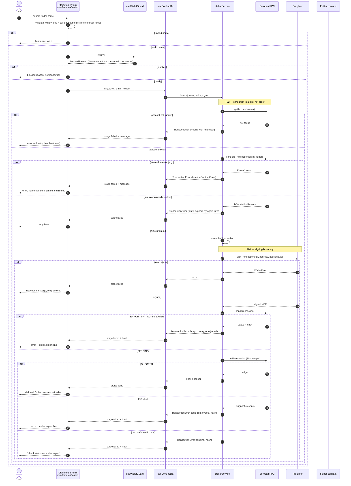
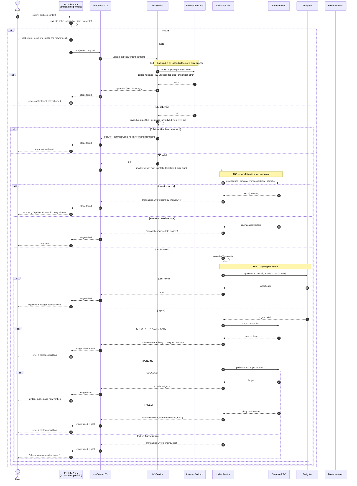
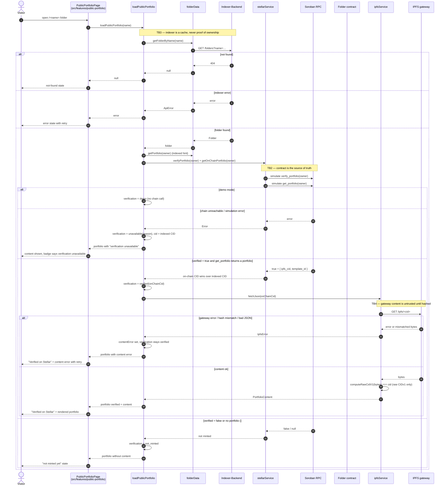

# Architecture

```
Browser (this repo)
  ├─ Freighter ── signs transactions
  ├─ Soroban RPC ── simulate / submit / poll; read-only verify_portfolio, get_portfolio
  ├─ Indexer-Backend ── GET /folders, /portfolios, /templates; POST /upload (pins to IPFS)
  └─ IPFS gateway ── reads portfolio and template JSON (verified against the CID)
```

## Layers

| Layer | Responsibility |
| --- | --- |
| `src/main.tsx` | Renders `ConfigErrorScreen` if `envErrors` is non-empty, otherwise the router and `App`. |
| `src/config/env.ts` | Parses and validates `VITE_*` variables (pure `parseEnv`, unit-tested). |
| `src/services/data/folderData.ts` | The only read path for Folder data: backend + IPFS, or demo fixtures when `VITE_DEMO_MODE=true`. Errors propagate. |
| `src/services/stellar/stellarService.ts` | Contract calls: build → simulate → `assembleTransaction` → sign → `sendTransaction` → `pollTransaction`. Read-only calls use simulation. |
| `src/services/stellar/freighterWallet.ts` | Freighter wrapper with typed errors. |
| `src/services/stellar/contractErrors.ts` | `ContractError` code → message mapping. |
| `src/services/ipfs/` | Backend upload, gateway reads, contract CID rules, raw CIDv1 computation. |
| `src/services/context/ServicesContext.tsx` | React Context for dependency injection of services (`folderData`, `freighterWallet`, `ipfsService`, `stellarService`). |
| `src/store/walletStore.ts` | Wallet state (address, network, status). |
| `src/features/*` | Wallet button and gate, folder overview and claim form, portfolio form, transaction status, public page and template layouts. |

## Dependency Injection (`ServicesProvider`)

To decouple components and hooks from module singletons and simplify test isolation, the application provides services via `ServicesProvider` and `useServices()`.

In production:
- `AppLayout` mounts `<ServicesProvider>` wrapping all routes with `defaultServices`.
- Hooks (`useFolder`, `usePortfolio`, `useTemplates`, `useContractTx`, `usePublicPortfolio`) consume services via `useServices()`.

In tests:
- Tests use the `renderWithServices(ui, { folderData: fakeData })` helper.
- No `vi.mock` module patching or `restoreMocks` is required for injected service dependencies.

## Trust model

- The **contract** is the source of truth. The public page loads content by the CID returned from
  `get_portfolio` and shows "Verified on Stellar" only when `verify_portfolio` returns true.
- The **indexer** is a cache used to find folders by name or owner. If it lags behind the chain, the
  on-chain CID wins.
- **IPFS content** is hashed and compared with its CID whenever the CID is a raw CIDv1 (what the
  backend produces for single-block files).
- The browser holds no secrets; uploads go through the backend.

## Flows

Sequence diagrams for the four user-facing flows. They are drawn from the code in
`src/features/*`, `src/services/stellar/stellarService.ts`, `src/services/ipfs/ipfsService.ts` and
`src/services/data/folderData.ts`; keep them in sync when those change.

Trust boundaries (identical in every diagram):

- **TB1 — Browser ↔ Freighter**: the browser never sees a secret key; Freighter signs only what the
  user approves, for the passphrase the app passes in.
- **TB2 — Browser ↔ Soroban RPC / contract**: the contract is the source of truth. Simulation and
  read-only calls are untrusted hints until the transaction is final on-chain.
- **TB3 — Browser ↔ Indexer-Backend**: the indexer is a cache and an upload relay; it is never
  trusted for ownership or content integrity.
- **TB4 — Browser ↔ IPFS gateway**: content is untrusted until its bytes are hashed and compared
  with the CID (raw CIDv1 only).

### Claim folder (`claim_folder`)



### Mint portfolio (`mint_portfolio`)



### Update portfolio (`update_portfolio`)

```mermaid
sequenceDiagram
    autonumber
    actor User
    participant UI as PortfolioForm<br/>(src/features/portfolio)
    participant Data as folderData
    participant IPFS as ipfsService
    participant BE as Indexer-Backend
    participant Svc as stellarService
    participant RPC as Soroban RPC
    participant W as Freighter
    participant C as Folder contract

    Note over UI,Data: TB4 — existing content is untrusted until CID-checked
    UI->>Data: getPortfolioContent(portfolio.ipfsCid)
    Data->>IPFS: fetchJson(cid)
    alt gateway unreachable / not pinned / hash mismatch / bad JSON
        IPFS-->>Data: IpfsError
        Data-->>UI: error
        UI-->>User: notice "current content could not be loaded; publishing replaces it"
    else content ok
        IPFS-->>Data: PortfolioContent
        Data-->>UI: prefilled form
    end

    User->>UI: submit changes
    UI->>UI: validate fields
    alt invalid
        UI-->>User: field errors, focus first invalid (no network call)
    else valid
        UI->>IPFS: uploadPortfolioContent(content)
        Note over IPFS,BE: TB3 — backend is an upload relay, not a trust anchor
        IPFS->>BE: POST /upload (portfolio.json)
        alt upload failed
            BE-->>IPFS: error
            IPFS-->>UI: IpfsError
            UI-->>User: error, retry allowed (old CID still on-chain)
        else CID returned
            BE-->>IPFS: { cid }
            IPFS->>IPFS: isValidContractCid + raw CIDv1 hash check
            alt CID invalid or mismatch
                IPFS-->>UI: IpfsError
                UI-->>User: error, retry allowed (old CID still on-chain)
            else CID valid
                IPFS-->>UI: cid
                UI->>Svc: invoke(owner, update_portfolio(cid), sign)
                Note over Svc,RPC: TB2 — simulation is a hint, not proof
                Svc->>RPC: getAccount + simulateTransaction(update_portfolio)
                alt simulation error (#4 FolderNotFound, #5 PortfolioNotFound, #8 InvalidCID, #7 Unauthorized)
                    RPC-->>Svc: Error(Contract, #N)
                    Svc-->>UI: TransactionError(describeContractError)
                    UI-->>User: error, retry allowed (old CID still on-chain)
                else simulation needs restore
                    RPC-->>Svc: isSimulationRestore
                    Svc-->>UI: TransactionError (state expired)
                    UI-->>User: retry later
                else simulation ok
                    Svc->>Svc: assembleTransaction
                    Note over Svc,W: TB1 — signing boundary
                    Svc->>W: signTransaction(xdr, address, passphrase)
                    alt user rejects
                        W-->>Svc: WalletError
                        Svc-->>UI: error
                        UI-->>User: rejection message, retry allowed
                    else signed
                        W-->>Svc: signed XDR
                        Svc->>RPC: sendTransaction
                        alt ERROR / TRY_AGAIN_LATER
                            RPC-->>Svc: status + hash
                            Svc-->>UI: TransactionError (busy → retry, or rejected)
                            UI-->>User: error + stellar.expert link
                        else PENDING
                            Svc->>RPC: pollTransaction (30 attempts)
                            alt SUCCESS
                                RPC-->>Svc: ledger
                                Svc-->>UI: { hash, ledger }
                                UI-->>User: updated, public page shows the new CID
                            else FAILED
                                RPC-->>Svc: diagnostic events
                                Svc-->>UI: TransactionError(code from events, hash)
                                UI-->>User: error + stellar.expert link (old CID still on-chain)
                            else not confirmed in time
                                Svc-->>UI: TransactionError(pending, hash)
                                UI-->>User: "check status on stellar.expert"
                            end
                        end
                    end
                end
            end
        end
    end
```

### Public verification (`verify_portfolio` / `get_portfolio`)



## Decisions

See [docs/adr/](adr/).
